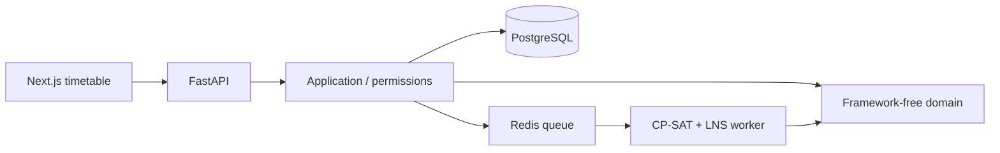

# Academic timetabling with explicit constraints

[](https://github.com/andresrubiop/academic-timetabling/actions/workflows/tests.yml)
[](LICENSE)

A research software platform for **university scheduling, what-if analysis and reviewed timetable changes**. The feasibility authority is **OR-Tools CP-SAT**; Large Neighborhood Search improves schedules within the same constraint model.

**FastAPI · PostgreSQL · SQLAlchemy/Alembic · Redis · Next.js/TypeScript · Docker**

This public source edition includes synthetic demo data and tests. It does not include an institution's timetable, student records, operational credentials, database backups or private development history. No trained AI model is bundled or active.

## What is implemented

- Academic catalog, offerings, sections, sessions, rooms, teachers, students and enrollment.
- A solver-independent scheduling domain with CP-SAT adapters and lexicographic objective tiers.
- Student conflict analysis, teacher availability and room restrictions.
- FET import, with unsupported constraints reported rather than silently claimed as enforced.
- Role and scope machinery, approval chains, audited change requests and explicit application of approved changes to a new timetable version.
- Timetable views and interactions in a Next.js interface.

## Why the architecture matters



The domain does not depend on FastAPI, SQLAlchemy or OR-Tools. PostgreSQL constraints and triggers enforce properties that an SQLite test suite would not exercise. Hard constraints and lexicographic objective tiers are kept explicit; the code does not silently turn institutional decisions into model predictions.

Design rationale is in [the ADRs](docs/adr/) and [architecture](ARCHITECTURE.md). See [known limitations](SECURITY.md) before using real data.

## Run a local synthetic demo

Requires Docker Compose and Python 3.11+ for the configuration helper.

```bash
git clone https://github.com/andresrubiop/academic-timetabling.git
cd academic-timetabling
python3 scripts/configure_demo.py
docker compose up -d --build
docker compose exec backend alembic upgrade head
docker compose exec -e BOOTSTRAP_PASSWORD='CHOOSE_A_UNIQUE_LOCAL_PASSWORD' \
  backend python -m academic_ai.bootstrap --email you@example.test
docker compose exec backend python -m academic_ai.demo
```

Open **http://127.0.0.1:5070** and sign in with the account you created. The demo command reports a period ID and refuses to mix synthetic records into a non-demo institution. The generated `.env` is private and ignored by Git. PostgreSQL and Redis have no published host ports; the web entry point binds to loopback.

This is a local research demo. Do not expose it on the public internet or load confidential records without addressing the limits below. An existing deployment is not modified by these instructions; use a separate directory and unused web port.

## Tests

```bash
cd backend
python3 -m venv .venv
. .venv/bin/activate
pip install -e '.[test]'
# Set TEST_DATABASE_URL and TEST_REDIS_URL to disposable test services.
export REDIS_URL="$TEST_REDIS_URL"  # API upload-preview storage uses this variable.
pytest -q

cd ../frontend
npm ci
npm test
npx tsc --noEmit
npm run build
```

Database fixtures create/drop test databases. **Use disposable PostgreSQL and Redis instances.** CI creates isolated services and supplies explicit test URLs. A small group of tests requiring an excluded institutional FET file is skipped in the public distribution; synthetic import tests remain available.

## Current limits

- There is no trained GNN, RL policy or neural scheduler. The AI interfaces are extension points, not model-quality claims.
- Scope enforcement has documented gaps, including whole-period schedule responses; this is not a production authorization certification.
- The local demo uses HTTP. A production deployment needs TLS, deployment-specific hardening and access review.
- The FET constraint vocabulary is larger than the implemented adapters. Review unsupported constraints and solver output for each import.
- The interface covers a subset of the backend's entities and workflows.

These limits are part of the project status, not hidden behind a production-ready label. See [provenance](PROVENANCE.md). By [Andrés Rubio Proaño](https://www.andresrubiop.com).
